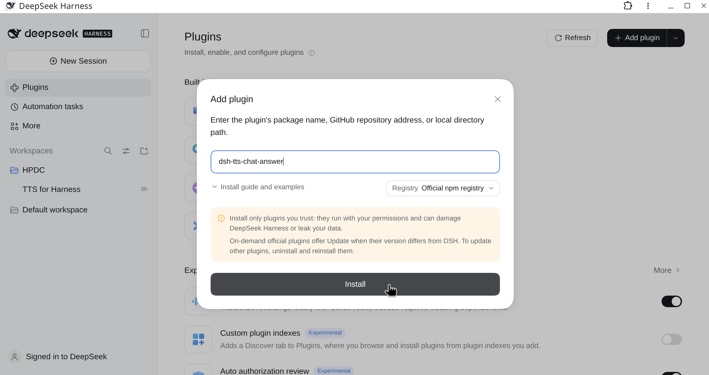
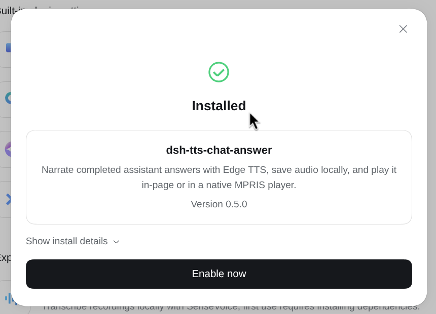
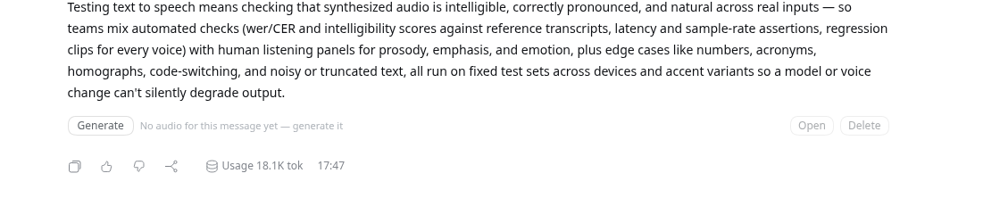
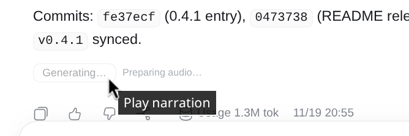
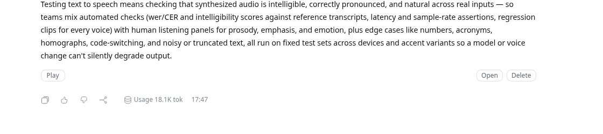
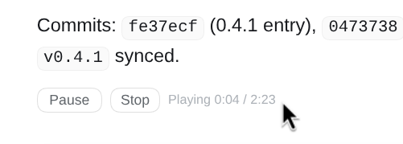

# TTS Chat Answer

`dsh-tts-chat-answer` narrates every completed assistant answer from DeepSeek
Harness and saves the audio locally for later playback and play from web UI.

## Contents

- [Install from the market, step by step](#install-from-the-market-step-by-step)
- [Install other ways](#install-other-ways)
- [Setup](#setup)
- [Storage](#storage)
- [Playback](#playback)
- [Voice choices](#voice-choices)
- [Market index](#market-index)
- [Publish a release](#publish-a-release)
- [Requirements](#requirements)
- [Configuration](#configuration)
- [Privacy](#privacy)
- [Test](#test)

## Install from the market, step by step

The package is a profile **bundle**: installing it also selects it as a layer.
The quickest path is the DSH **Plugins** page. Custom index users add its source
under **Plugins → Discover → Add index source** first:

```text
https://vladimircores.github.io/dsh-tts-chat-answer/index.json
```

Then follow the dialog through install and enable. These captures follow that
flow and the first generated answer:

| Step | What happens | Screenshot |
|:--:|---|---|
| 1 | In **Plugins → Add plugin**, type `dsh-tts-chat-answer`, keep the npm registry, and press **Install**. |  |
| 2 | The dialog confirms **Installed** with the package version. Press **Enable now**; restart DSH if the row does not appear yet. |  |
| 3 | A message written before the plugin existed has no audio, so its footer offers **Generate** instead of Play. |  |
| 4 | The control reads **Generating…** and the hint reads `Preparing audio…` while the Host synthesizes the MP3. |  |
| 5 | When the file is saved, the control becomes **Play**. |  |
| 6 | During playback it shows **Pause**, **Stop**, and the elapsed position. |  |

Prefer one image? [screenshots/social-card.png](screenshots/social-card.png) is the
same walkthrough as a single 1200×1700 card for social posts.

## Install other ways

From npm, which serves the same tarball the market installs:

```bash
dsh plugin --profile web add dsh-tts-chat-answer
```

From GitHub, which needs no build step because the JavaScript is committed:

```bash
dsh plugin --profile web add github:VladimirCores/dsh-tts-chat-answer
```

From a checkout, install the plugin's own dependencies and link it:

```bash
cd /absolute/path/to/dsh-tts-chat-answer
npm install
dsh plugin --profile web add .
```

`dsh plugin add` installs the dependency and selects the bundle in
`~/.dsh/profiles/web/package.json`. If a package ends up installed but not
selected, add `dsh-tts-chat-answer` to `dsh.profile.bundles`. A running profile
does not always hot-add a new row, so restart the Host; afterwards
`~/.local/share/dsh-tts-chat-answer/.ready` proves the plugin mounted. Disable
it with `dsh plugin --profile web remove dsh-tts-chat-answer`, or set
`enabled: false` in the profile patch.

pnpm 11 applies a **24-hour `minimumReleaseAge` cooldown** by default. A version
published in the last day is listed in the index but still fails to install with
`ERR_PNPM_MINIMUM_RELEASE_AGE_VIOLATION`, and even removing it fails while the
lockfile holds that version. Wait until the release is a day old, or set
`minimumReleaseAge: 0` in the profile's `pnpm-workspace.yaml` (for example
`~/.dsh/profiles/web/pnpm-workspace.yaml`) to install immediately. Restore the
setting afterwards so later installs keep the cooldown.

## Setup

After installing, run the interactive setup:

```bash
npx -p dsh-tts-chat-answer setup
```

From a checkout, run `node setup.mjs` instead. The prompt asks for the profile,
the voice, and the playback mode, then writes a managed `tts-chat-answer`
override into that profile's `cordis.patch.yml`. Restart the Host afterwards;
`~/.local/share/dsh-tts-chat-answer/.ready` appears once the plugin mounts.

The voice menu is a numbered selector: pick a preset or the custom row and type
any Edge voice id. The playback menu offers `inline` (in-page audio) or `native`
(system player with in-page fallback). Options: `--profile web` skips the
profile question, `--yes` accepts the defaults, and `--dry-run` prints the
generated YAML without writing. Re-running updates the block delimited by
`# >>> dsh-tts-chat-answer setup >>>` in place and saves a timestamped copy of
the previous patch file.

## Storage

The plugin stores audio files in `~/.local/share/dsh-tts-chat-answer/`, grouped
by workspace and date. Each turn becomes:

```
~/.local/share/dsh-tts-chat-answer/
├── .ready                          # written when the plugin mounts
├── index.jsonl                     # global one-line-per-job index (includes workspace)
└── HPDC-7c1e9a02/                  # workspace basename + short cwd hash
    └── 2026-11-19/
        ├── 2026-11-19_14-05-33_<session>_t3.mp3
        ├── 2026-11-19_14-05-33_<session>_t3.txt   # transcript of the answer
        └── 2026-11-19_14-05-33_<session>_t3.json  # metadata
```

Each workspace gets its own folder, derived from the session's recorded
`cwd` (`basename` plus an 8-character SHA-1 prefix of the absolute path). Two
different projects named `HPDC` therefore do not collide. Sessions without a
recorded workspace land in `_unknown-workspace/`. Set
`groupByWorkspace: false` to write a flat `<date>/` tree instead.

The MP3 contains the final text-only assistant message of the turn. Markdown,
tables, links and code fences are converted to spoken prose; code blocks are
replaced with “Code block omitted” rather than read aloud. Intermediate
tool-call preambles are skipped.

## Playback

Each completed turn gets a small control in the completed-turn footer, next to
the message actions. It checks the authenticated readiness route:

```text
GET /dsh-tts-chat-answer/status?session=<session-id>&turn=<turn>
```

While the MP3 is being generated it shows `Generating…`; once ready it shows
`Play`. The host reports `playMode` in the same response.

Messages that existed before the plugin was installed have no MP3, so their
control shows `Generate` instead of `Play`. Clicking it narrates that existing
answer and then polls until the audio is ready:

```text
POST /dsh-tts-chat-answer/generate
{"session":"<session-id>","turn":<turn>}
```

A turn whose last attempt failed shows `Retry`. Generation uses the same queue,
voice, and output layout as automatic narration.

`playMode: "inline"` (the default) plays in the Web UI through one shared
`HTMLAudioElement`. The control becomes `Pause` while playing and `Resume`
while paused; a `Stop` button resets it. Pressing Play on another answer stops
the current one, so only one answer ever plays. No external application is
opened.

`playMode: "native"` asks the Host to hand the MP3 to the platform's default
audio application (`xdg-open` on Linux, `open` on macOS, `start` on Windows)
and reports state through MPRIS:

```text
POST /dsh-tts-chat-answer/open
{"session":"<session-id>","turn":<turn>}

POST /dsh-tts-chat-answer/playback
{"session":"<session-id>","turn":<turn>,"action":"play|pause|stop"}
```

On Linux the Host matches the player by `xesam:title` / `xesam:url`, then uses
the standard MPRIS `Play`, `Pause`, `Stop`, and `Quit` methods. The UI follows
`PlaybackStatus`; pressing `Stop`, reaching the end, or starting another answer
stops and closes the player. Only one native player opened by this plugin is
tracked at a time. If no controllable MPRIS player appears, the client falls
back to the in-page player for that turn.

MPRIS control is Linux-only. On macOS and Windows native mode still opens the
default app, but cannot reflect or close it from the chat; choose `inline`
there. Both playback modes use the same browser auth as the rest of the Web app;
the audio files are not public static directories. Set `openCommand` if the
platform opener is not on `PATH` or needs a custom command.

This package has a Web client half (`lib/client.js`, declared under
`dsh.client`). Restart DSH after installing or updating it so the client
boot manifest includes the bundle; client-plugin HMR only applies while
`pnpm run dev:web` is running.

## Voice choices

The interactive setup shows a numbered voice menu. The built-in choices are:

| Voice | Accent / tone |
|---|---|
| `en-US-AriaNeural` | US English, female, warm (default) |
| `en-US-JennyNeural` | US English, female, friendly |
| `en-US-GuyNeural` | US English, male, calm |
| `en-US-DavisNeural` | US English, male, deep |
| `en-GB-SoniaNeural` | British English, female |
| `en-GB-RyanNeural` | British English, male |
| `en-AU-NatashaNeural` | Australian English, female |
| `en-CA-ClaraNeural` | Canadian English, female |
| `en-IN-NeerjaNeural` | Indian English, female |
| `de-DE-KatjaNeural` | German, female |
| `fr-FR-DeniseNeural` | French, female |
| `es-ES-ElviraNeural` | Spanish, female |

Choose the last menu row to enter any other Edge voice id. The setup derives
`fallbackVoice` from the primary voice (Aria and Guy swap); the advanced
section lets you override it. The fallback is only used when Edge returns no
audio for the primary voice.

## Market index

The package is published on npm as `dsh-tts-chat-answer` and declares
`dsh.bundle`, an `engines.dsh` range, an icon, an English locale, and its
repository/author metadata, so a DSH plugin index can list it.

`site/index.json` is deployed by `.github/workflows/pages.yml` and served at
<https://vladimircores.github.io/dsh-tts-chat-answer/>.

Regenerate the entry with the reference generator after a release:

```bash
pnpm --filter @deepseek-ai/dsh-plugin-market-generator start \
  --input plugins.txt --output site/index.json --title "TTS Chat Answer"
```

`plugins.txt` holds one line per source: the npm name produces an npm entry; an
`https://` Git URL produces a commit-pinned entry instead. See the
[plugin index guide](https://deepseek-harness.github.io/deepseek-harness/en/guide/plugin-market).

## Publish a release

The bundle ships plain JavaScript, so the tarball needs no build step and a Git
install works from the committed `lib/` tree. Check the package first:

```bash
npm test                # 15 tests
npm run pack:check      # inspect the exact tarball contents
npm publish --dry-run   # validates metadata; uploads nothing
```

`files` must keep every runtime module, the patch, the locale, the icon, and
`setup.mjs`. A file added to `lib/` but missing from `files` loads from the
checkout and fails after `dsh plugin add`. The setup command is declared in
`bin` without a `./` prefix because npm rejects and silently drops a prefixed
path at publish time.

Then publish and tag:

```bash
npm version patch        # bumps package.json, commits, tags vX.Y.Z
npm publish
git push --follow-tags
```

After the registry accepts the version, prepend it to `site/index.json`: set
`version`, set `publishTimestamp` to the registry time (`npm view
dsh-tts-chat-answer time --json`), and keep `source` as `{"type": "npm"}`. Keep
earlier versions in the array so the page can install them. The Pages workflow
republishes `site/` on the next push.

Expect a one-day gap before the new entry is installable: pnpm's default
24-hour release-age cooldown rejects any version younger than that. The
[Install other ways](#install-other-ways) note explains the workaround and when
to restore the setting.

## Requirements

- `edge-tts` for the default engine. It is installed at
  `~/.local/bin/edge-tts` on this machine; the plugin also tries `edge-tts`
  from `PATH`.
- `ffmpeg` when an answer is split into more than one chunk. Without it the
  plugin falls back to a single request.
- `espeak-ng` + `ffmpeg` for the fully local engine.
- `native` playback on Linux needs `busctl` and an MPRIS-capable audio player
  (GNOME Decibels, VLC, etc.). Without MPRIS the client falls back to the
  in-page player.

## Configuration

| key | default | meaning |
|---|---|---|
| `enabled` | `false` | Master switch. The shipped bundle defaults to off; enable it explicitly. |
| `outputDir` | `~/.local/share/dsh-tts-chat-answer` | Root for audio, transcripts, metadata, index. |
| `groupByWorkspace` | `true` | Put each workspace in `<basename>-<cwd-hash>/`; `false` writes `<date>/` directly. |
| `engine` | `edge` | `edge` (neural, online) or `espeak` (robotic, local). |
| `playMode` | `inline` | `inline` (in-page audio, default) or `native` (system app with MPRIS control and in-page fallback). |
| `voice` | `en-US-AriaNeural` | Edge voice; setup offers a numbered menu. |
| `fallbackVoice` | `en-US-GuyNeural` | Retry voice when Edge returns no audio for the primary voice. |
| `rate` / `volume` / `pitch` | `+10%` / `+0%` / `+0Hz` | Edge prosody. |
| `minChars` | `40` | Skip turns with almost no speakable text. |
| `maxChars` | `12000` | Truncate longer answers at a sentence boundary. |
| `chunkChars` | `1200` | Per-request chunk budget; smaller chunks synthesize faster in parallel. |
| `concurrency` | `2` | Parallel Edge TTS requests. |
| `timeoutMs` | `600000` | Per-process deadline. |
| `maxQueue` | `20` | Backpressure guard. |
| `includeSubagents` | `false` | Narrate subagent sessions too. |
| `includeIncomplete` | `false` | Narrate `max-tokens` turns as well as completed turns. |
| `keepTranscript` | `true` | Write the raw answer text next to the audio. |
| `redactSecrets` | `true` | Best-effort removal of API keys, private keys, JWTs, etc. |
| `edgeTtsCommand` | `edge-tts` | Override the executable. |
| `ffmpegCommand` | `ffmpeg` | Override ffmpeg. |
| `openCommand` | auto | Override the system opener used by `POST /dsh-tts-chat-answer/open`; the path is appended as its only argument. |
| `espeakCommand` / `espeakVoice` / `espeakRate` | `espeak-ng` / `en-us` / `165` | Local engine settings. |

## Privacy

The bundle ships disabled so installing it does not immediately send chat
answers anywhere. Enable it explicitly (the setup prompt asks) before use.

`engine: "edge"` sends the **speech script of every assistant answer** to
Microsoft's Edge TTS service. `redactSecrets` and code-block omission reduce
exposure but are not a guarantee. If responses may contain confidential data,
use `engine: "espeak"` (fully local) or disable the plugin.

## Test

```bash
npm install
npm test
```

The integration test performs a real Edge TTS synthesis (about 20 seconds).
